# MASTER-INTERNAL-LINKING-REFERENCE.md
## Permanent Source of Truth for Site-Wide Internal Linking & Topical Authority

> **Status:** ACTIVE & MANDATORY REFERENCE  
> **Property:** sicher-umzug.at (sc-domain:sicher-umzug.at)  
> **Last Updated:** 2026-10-31  
> **Authority Baseline:** Google Search Console Real Performance Data (August–October 2026)  

---

## 1. Executive Overview & Core Objectives

This document establishes the permanent site-wide internal linking architecture and topical authority model for `sicher-umzug.at`. The website functions not as a collection of isolated blog posts or siloed landing pages, but as an interconnected **Spider-Web SEO Ecosystem**.

### Primary Ranking Targets (Tier 1 Priorities)
1. **Homepage (`/`)**
   - **Target Query Cluster:** `Umzugsfirma Wien`, `Umzugsunternehmen Wien`, `Beste Umzugsfirma Wien`, `Günstige Umzugsfirma Wien`, `Sicher Team`
   - **SEO Priority:** CRITICAL (Tier 1A) — Brand & Commercial Master Pillar.
   - **GSC Baseline:** 2,989 impressions, 53 clicks, avg. pos 10.5 for `umzugsfirma wien`. Immediate candidate for Top 3.
2. **Umzug Wien Hub (`/leistungen/umzug-wien/`)**
   - **Target Query Cluster:** `Umzug Wien`, `Professioneller Umzug Wien`, `Übersiedlung Wien`, `Wohnungsumzug Wien`, `Umzugsservice Wien`
   - **SEO Priority:** CRITICAL (Tier 1B) — City-Wide Service Pillar.
   - **GSC Baseline:** 157 impressions, pos 86.9 for long-tail queries. Massive growth potential once spider-web links are in place.
3. **Commercial / Decision Bridge (`/ratgeber/umzugsfirma-vergleichen/`)**
   - **Target Query Cluster:** `Umzugsfirma vergleichen Wien`, `Umzugsunternehmen Kosten Vergleich`, `Seriöse Umzugsfirmen Wien`
   - **SEO Priority:** HIGH (Tier 1C) — High-intent transactional guide directly funnelling qualified traffic to Homepage and Umzug Wien.

---

## 2. Google Search Console Performance Analysis

Based on verified Google Search Console data from `sc-domain:sicher-umzug.at`, the site received over **15,200 impressions** across all queries.

### Top Commercial Moving Queries & Current SERP Status
| Query | Impressions | Clicks | CTR | Current Avg. Pos | Ranking URL | Opportunity Analysis |
|---|---|---|---|---|---|---|
| `sicherteam umzug & räumung` | 99 | 4 | 4.0% | 1.7 | `/` | High volume; push to Top 3 |
| `auslandsumzug` | 65 | 0 | 0.0% | 82.5 | `/leistungen/auslandsumzug/` | Long-tail; needs topical hub link |
| `umzugsfirma wien` | 53 | 2 | 3.8% | 10.5 | `/` | High volume; push to Top 3 |
| `firmenumzug` | 52 | 0 | 0.0% | 89.2 | `/` | Long-tail; needs topical hub link |
| `gratis umzugsangebot wien` | 51 | 0 | 0.0% | 77.9 | `/angebot/` | Long-tail; needs topical hub link |
| `kostenloses umzugsangebot wien` | 46 | 0 | 0.0% | 82.5 | `/angebot/` | Long-tail; needs topical hub link |
| `firmenumzug wien` | 44 | 0 | 0.0% | 90.7 | `/leistungen/firmenumzug-wien/` | Long-tail; needs topical hub link |
| `internationale übersiedlungen` | 43 | 0 | 0.0% | 10.0 | `/` | High volume; push to Top 3 |
| `umzugsservice` | 38 | 1 | 2.6% | 10.7 | `/` | High volume; push to Top 3 |
| `halteverbotszone umzug wien` | 36 | 0 | 0.0% | 77.2 | `/ratgeber/2026-04-26-halteverbotszone-fuer-umzug-beantragen/` | Long-tail; needs topical hub link |
| `hausumzug wien` | 28 | 0 | 0.0% | 81.2 | `/leistungen/` | Long-tail; needs topical hub link |
| `auslandsumzug wien` | 26 | 0 | 0.0% | 86.8 | `/ratgeber/entruempelung-auswanderung-umzug-ausland-wien/` | Long-tail; needs topical hub link |
| `internationaler umzug wien` | 24 | 0 | 0.0% | 95.8 | `/leistungen/auslandsumzug/` | Long-tail; needs topical hub link |
| `büroumzug wien` | 19 | 0 | 0.0% | 97.8 | `/leistungen/firmenumzug-wien/` | Long-tail; needs topical hub link |
| `kosten für umzugsunternehmen` | 17 | 0 | 0.0% | 94.2 | `/preise/` | Long-tail; needs topical hub link |
| `fernumzug` | 15 | 0 | 0.0% | 78.5 | `/` | Long-tail; needs topical hub link |
| `sicher umzug` | 13 | 5 | 38.5% | 3.5 | `/` | High volume; push to Top 3 |
| `firmenübersiedlung oberösterreich` | 13 | 0 | 0.0% | 67.4 | `/bundesland/oberoesterreich/` | Long-tail; needs topical hub link |
| `gute umzugsfirma` | 12 | 0 | 0.0% | 79.0 | `/` | Long-tail; needs topical hub link |
| `komplettumzug kosten` | 12 | 0 | 0.0% | 99.0 | `/` | Long-tail; needs topical hub link |
| `budget umzug` | 10 | 0 | 0.0% | 72.9 | `/` | Long-tail; needs topical hub link |
| `firmenumzug niederösterreich` | 9 | 0 | 0.0% | 61.3 | `/bundesland/niederoesterreich/` | Long-tail; needs topical hub link |
| `firmenumzug salzburg` | 7 | 0 | 0.0% | 91.0 | `/bundesland/salzburg/` | Long-tail; needs topical hub link |
| `full service umzug` | 7 | 0 | 0.0% | 68.9 | `/` | Long-tail; needs topical hub link |
| `festumzug` | 6 | 0 | 0.0% | 91.0 | `/ratgeber/` | Long-tail; needs topical hub link |

### Key Audit Discovery: The Inbound Link Vacuum on the Homepage
- Prior to this master plan, **ZERO (0) guides, ZERO (0) district pages, and ZERO (0) service pages** linked to the Homepage (`/`) within their main body text.
- The only inbound links to the Homepage were 6 generic links with anchor text `Startseite` or `Zurück zur Startseite`.
- Despite this lack of body link equity, the Homepage ranks at **position 10.5 for `umzugsfirma wien`**! Injecting descriptive, high-authority contextual links from body content will deliver the exact PageRank and semantic signals needed to break into the Top 3.

---

## 3. Topical Clusters & Content Ecosystem

The website content is structured into 7 functional clusters:

### Cluster: Clearance & Property Disposal (23 pages | 3430 Impressions | 2 Clicks)
- **Role in Ecosystem:** Provides specialized content, captures long-tail search intent, and passes topical authority upward to Tier 1.
- **Top 5 URLs by Visibility:**
  * `/leistungen/gratis-raeumung/` — 1654 imp, 0 clicks, 0 inbound links (Title: Weiterleitung...)
  * `/leistungen/gratis-entruempelung/` — 960 imp, 0 clicks, 4 inbound links (Title: Gratis Entrümpelung: wann ist sie möglich?...)
  * `/leistungen/kellerraeumung/` — 141 imp, 0 clicks, 10 inbound links (Title: Kellerräumung...)
  * `/leistungen/firmenaufloesung/` — 132 imp, 0 clicks, 6 inbound links (Title: Firmen- & Büroauflösung...)
  * `/leistungen/raeumung/` — 131 imp, 1 clicks, 51 inbound links (Title: Räumung in Wien, NÖ & Burgenland...)

### Cluster: Core Target Pages (2 pages | 3146 Impressions | 53 Clicks)
- **Role in Ecosystem:** Provides specialized content, captures long-tail search intent, and passes topical authority upward to Tier 1.
- **Top 5 URLs by Visibility:**
  * `/` — 2989 imp, 53 clicks, 6 inbound links (Title: Umzugsfirma Wien & Umzug Wien | Fixpreis ab 4...)
  * `/leistungen/umzug-wien/` — 157 imp, 0 clicks, 41 inbound links (Title: Umzug Wien: gut geplant durch die Stadt....)

### Cluster: Informational Guides & Ratgeber (98 pages | 3677 Impressions | 1 Clicks)
- **Role in Ecosystem:** Provides specialized content, captures long-tail search intent, and passes topical authority upward to Tier 1.
- **Top 5 URLs by Visibility:**
  * `/ratgeber/gratis-entruempelung-wien/` — 956 imp, 0 clicks, 5 inbound links (Title: Gratis entrümpeln? Wert und Räumungskosten ve...)
  * `/ratgeber/firmenauflesung-bueroraeumung-wien-dsgvo/` — 238 imp, 0 clicks, 0 inbound links (Title: Firmenauflösung & Büroräumung in Wien: DSGVO-...)
  * `/ratgeber/gebrauchte-moebel-verkaufen-wien/` — 216 imp, 0 clicks, 0 inbound links (Title: Gebrauchte Möbel bewerten in Wien: Schrott od...)
  * `/ratgeber/umzugskosten-oesterreich-sparen/` — 190 imp, 0 clicks, 5 inbound links (Title: Umzugskosten in Österreich: Angebote vergleic...)
  * `/ratgeber/halteverbot-entrumpelung-wien/` — 181 imp, 0 clicks, 0 inbound links (Title: Halteverbot für die Entrümpelung in Wien bean...)

### Cluster: Interactive Tools & Calculators (10 pages | 10 Impressions | 0 Clicks)
- **Role in Ecosystem:** Provides specialized content, captures long-tail search intent, and passes topical authority upward to Tier 1.
- **Top 5 URLs by Visibility:**
  * `/umzugsvolumen-rechner/` — 4 imp, 0 clicks, 10 inbound links (Title: Umzugsvolumen-Rechner & Möbelliste...)
  * `/umzugskarton-rechner/` — 3 imp, 0 clicks, 10 inbound links (Title: Umzugskarton-Rechner: Wie viele Kartons brauc...)
  * `/umzugskosten-rechner/` — 3 imp, 0 clicks, 9 inbound links (Title: Umzugskosten-Rechner für Ihre Übersiedlung...)
  * `/kostenanfrage-vorbereiten/` — 0 imp, 0 clicks, 12 inbound links (Title: Kostenanfrage für Ihren Umzug vorbereiten...)
  * `/adressaenderung-checkliste/` — 0 imp, 0 clicks, 5 inbound links (Title: Adressänderung: Ihre Checkliste...)

### Cluster: Moving Core Services (14 pages | 660 Impressions | 0 Clicks)
- **Role in Ecosystem:** Provides specialized content, captures long-tail search intent, and passes topical authority upward to Tier 1.
- **Top 5 URLs by Visibility:**
  * `/leistungen/auslandsumzug/` — 179 imp, 0 clicks, 6 inbound links (Title: Auslandsumzug ab Österreich...)
  * `/leistungen/firmenumzug-wien/` — 115 imp, 0 clicks, 26 inbound links (Title: Firmenumzug Wien: den Standortwechsel planen....)
  * `/leistungen/moebelmontage/` — 96 imp, 0 clicks, 23 inbound links (Title: Möbelmontage beim Umzug...)
  * `/leistungen/verpackungsservice/` — 73 imp, 0 clicks, 17 inbound links (Title: Verpackungsservice für Ihren Umzug...)
  * `/leistungen/seniorenumzug/` — 56 imp, 0 clicks, 5 inbound links (Title: Seniorenumzug persönlich planen...)

### Cluster: States & Inter-City Moving (30 pages | 1513 Impressions | 6 Clicks)
- **Role in Ecosystem:** Provides specialized content, captures long-tail search intent, and passes topical authority upward to Tier 1.
- **Top 5 URLs by Visibility:**
  * `/bundesland/niederoesterreich/` — 343 imp, 0 clicks, 12 inbound links (Title: Umzug in Niederösterreich planen...)
  * `/bundesland/wien/` — 290 imp, 2 clicks, 6 inbound links (Title: Wiener Bezirke und Umzugsplanung...)
  * `/ratgeber/behoerdenwege-nach-umzug-oesterreich/` — 113 imp, 0 clicks, 4 inbound links (Title: Adressänderungen nach dem Umzug in Österreich...)
  * `/ratgeber/halteverbotszone-umzug-oesterreich/` — 91 imp, 0 clicks, 13 inbound links (Title: Halteverbotszone für Ihren Umzug...)
  * `/bundesland/salzburg/` — 82 imp, 2 clicks, 4 inbound links (Title: Umzug nach oder aus Salzburg...)

### Cluster: Trust & Conversion Pages (80 pages | 1368 Impressions | 5 Clicks)
- **Role in Ecosystem:** Provides specialized content, captures long-tail search intent, and passes topical authority upward to Tier 1.
- **Top 5 URLs by Visibility:**
  * `/ratgeber/` — 554 imp, 0 clicks, 3 inbound links (Title: Gut vorbereitet übersiedeln....)
  * `/preise/` — 182 imp, 0 clicks, 50 inbound links (Title: Was kostet Ihr Umzug?...)
  * `/bezirke/` — 149 imp, 0 clicks, 6 inbound links (Title: Umziehen in Österreich. Start und Ziel verbin...)
  * `/angebot/` — 127 imp, 0 clicks, 79 inbound links (Title: Ihr Vorhaben. Ihr unverbindliches Angebot....)
  * `/leistungen/` — 93 imp, 0 clicks, 7 inbound links (Title: Ihr Umzug. Die passende Unterstützung....)

### Cluster: Vienna & Metro Districts (35 pages | 1397 Impressions | 0 Clicks)
- **Role in Ecosystem:** Provides specialized content, captures long-tail search intent, and passes topical authority upward to Tier 1.
- **Top 5 URLs by Visibility:**
  * `/leistungen/umzug-1060-wien/` — 238 imp, 0 clicks, 7 inbound links (Title: Umzug in 1060 Wien (Mariahilf)...)
  * `/leistungen/umzug-1150-wien/` — 118 imp, 0 clicks, 5 inbound links (Title: Umzug in 1150 Wien (Rudolfsheim-Fünfhaus)...)
  * `/leistungen/umzug-1050-wien/` — 109 imp, 0 clicks, 5 inbound links (Title: Umzug in 1050 Wien (Margareten)...)
  * `/leistungen/umzug-1220-wien/` — 88 imp, 0 clicks, 4 inbound links (Title: Umzug in 1220 Wien (Donaustadt)...)
  * `/leistungen/umzug-1230-wien/` — 80 imp, 0 clicks, 6 inbound links (Title: Umzug in 1230 Wien (Liesing)...)

---

## 4. The Spider-Web Internal Linking Architecture

The website architecture follows strict bidirectional link flows:

```mermaid
graph TD
    subgraph Tier1 [Tier 1: Core Target Pillars]
        HOME["/ (Homepage: Umzugsfirma Wien)"]
        HUB["/leistungen/umzug-wien/ (Umzug Wien Hub)"]
    end

    subgraph Tier2 [Tier 2: Moving Core Services]
        PRIVAT["/leistungen/privatumzug/"]
        FIRMEN["/leistungen/firmenumzug-wien/"]
        MONTAGE["/leistungen/moebelmontage/"]
        TRANSPORT["/leistungen/moebeltransport/"]
        PACK["/leistungen/verpackungsservice/"]
    end

    subgraph Tier3 [Tier 3: 23 Vienna Districts]
        D1010["/leistungen/umzug-1010-wien/"]
        D1020_1230["/leistungen/umzug-1020-wien/ bis 1230-wien/"]
    end

    subgraph Tier4 [Tier 4: Informational Guides & Ratgeber]
        G_VERGLEICH["/ratgeber/umzugsfirma-vergleichen/"]
        G_HALTEVERBOT["/ratgeber/halteverbotszone-umzug-wien/"]
        G_CHECKLISTE["/ratgeber/umzugscheckliste-oesterreich/"]
        G_KOSTEN["/ratgeber/umzugskosten-wien-preise-berechnen/"]
    end

    subgraph Tier5 [Tier 5: Interactive Calculation Tools]
        T_KOSTEN["/umzugskosten-rechner/"]
        T_KARTON["/umzugskarton-rechner/"]
        T_PLANER["/umzugsplaner/"]
    end

    HOME <-->|Bidirectional High Authority| HUB
    HOME <-->|Core Services Linkage| PRIVAT & FIRMEN & MONTAGE
    HUB <-->|District Network Linkage| D1010 & D1020_1230
    D1010 & D1020_1230 -->|Authority Uplink to Home| HOME
    G_VERGLEICH & G_HALTEVERBOT & G_CHECKLISTE -->|Contextual Link to Home| HOME
    G_VERGLEICH & G_HALTEVERBOT & G_KOSTEN -->|Contextual Link to Hub| HUB
    T_KOSTEN & T_KARTON & T_PLANER -->|Commercial Conversion Uplink| HOME & HUB
```

### Flow Rules
1. **Upward Authority Flows (Tiers 3, 4, 5 → Tier 1):** Every guide, district page, and tool must link contextually to either the Homepage (`/`) or the Umzug Wien Hub (`/leistungen/umzug-wien/`) or both.
2. **Horizontal Flows (Sibling Cross-Linking):** Services supporting each other must cross-link contextually (e.g. `privatumzug` ↔ `moebelmontage` ↔ `verpackungsservice`).
3. **Downward Navigation Flows (Tier 1 → Supporting Hubs):** The Homepage and Umzug Wien Hub link to key service pillars, district overviews, cost calculators, and checklists.

---

## 5. Strategic Anchor Text Optimization Matrix

To avoid Google over-optimization penalties while maximizing semantic topical relevance, anchor texts must follow strict variation rules:

### Target 1: Homepage (`/`) — Target Concept: *Umzugsfirma Wien*
| Category | Approved Natural Anchor Texts | Allocation Target | Usage Context |
|---|---|---|---|
| **Exact Match** | `Umzugsfirma Wien`, `Wiener Umzugsfirma` | 25% | Commercial guides, comparison guides, footer district summaries |
| **Brand + Modifier** | `Sicher Team Umzugsfirma`, `Wiener Umzugsunternehmen Sicher Team`, `Umzugsfirma Sicher Team` | 30% | High-authority guides, partner references, district intros |
| **Partial Match** | `professionelle Umzugsfirma in Wien`, `erfahrene Umzugsfirma für Wien`, `Umzugsfirma in Wien finden` | 25% | Editorial text, advice guides, planning articles |
| **Semantic Entity** | `Wiener Umzugsunternehmen`, `zertifiziertes Umzugsunternehmen`, `Full-Service Umzugsfirma` | 20% | Legal, insurance, and corporate service guides |

### Target 2: Umzug Wien Hub (`/leistungen/umzug-wien/`) — Target Concept: *Umzug Wien*
| Category | Approved Natural Anchor Texts | Allocation Target | Usage Context |
|---|---|---|---|
| **Exact Match** | `Umzug Wien`, `Umzug in Wien` | 30% | Vienna district pages, regional route articles |
| **Partial Match** | `professioneller Umzug in Wien`, `reibungsloser Umzug Wien`, `Wohnungsumzug in Wien` | 30% | Moving checklist, packaging guides, Altbau guides |
| **Service Action** | `Umzugsservice Wien`, `Umzugsanfrage in Wien`, `Übersiedlungsservice Wien` | 25% | Cost calculator, offer flow, preparation guides |
| **Synonym (Austrian)** | `Übersiedlung in Wien`, `Wiener Übersiedlung`, `Wohnung übersiedeln in Wien` | 15% | Austrian legal guides, tenancy guides, district guides |

---

## 6. Source URL → Destination URL Implementation Blueprint

The following table details the exact internal links to be embedded into content bodies:

| Source URL / Group | Source Title | Recommended Destination URL | Recommended Anchor Text | Placement Context / Sentence |
|---|---|---|---|---|
| `_districts/umzug-1010-wien.md` bis `1230-wien.md` (23 pages) | Alle 23 Wiener Bezirke | `/` (Homepage) | `erfahrene Umzugsfirma in Wien` / `Wiener Umzugsfirma Sicher Team` | Im Einleitungssatz: 'Als erfahrene [Umzugsfirma in Wien](/) übernimmt Sicher Team...' |
| `_guides/umzugsfirma-vergleichen.md` | Umzugsfirma vergleichen | `/` (Homepage) | `professionelle Umzugsfirma in Wien` | Im Hauptabschnitt: 'Vor der Entscheidung für eine [professionelle Umzugsfirma in Wien](/)...' |
| `_guides/umzugsfirma-vergleichen.md` | Umzugsfirma vergleichen | `/leistungen/umzug-wien/` | `professionellen Umzug in Wien` | Unter 'Passende Services': '[Umzug Wien](/leistungen/umzug-wien/): Unser Service für alle 23 Bezirke' |
| `_guides/umzugskosten-oesterreich-sparen.md` | Umzugskosten sparen | `/preise/` & `/` | `transparenten Fixpreisen einer Wiener Umzugsfirma` | Im Kostenvergleichsabschnitt |
| `_guides/umzugskosten-oesterreich-sparen.md` | Umzugskosten sparen | `/leistungen/umzug-wien/` | `Umzug in Wien` | Bei der Besprechung von Tragewegen und Halteverbotszonen |
| `_guides/halteverbotszone-umzug-oesterreich.md` | Halteverbotszone Umzug | `/leistungen/umzug-wien/` | `Umzug Wien` | Bei behördlicher Anmeldung und MA 46 Vorgaben |
| `_guides/halteverbotszone-umzug-oesterreich.md` | Halteverbotszone Umzug | `/` | `Wiener Umzugsunternehmen` | 'Ein zuverlässiges [Wiener Umzugsunternehmen](/) übernimmt die Schilderaufstellung...' |
| `_guides/umzugscheckliste-oesterreich.md` | Umzugscheckliste Österreich | `/leistungen/umzug-wien/` | `Übersiedlung in Wien` | Bei der 4-Wochen-Frist für Vor-Ort-Besichtigungen |
| `_guides/umzugscheckliste-oesterreich.md` | Umzugscheckliste Österreich | `/` | `seriösen Umzugsfirma Wien` | Bei der Auswahl von Transportpartnern |
| `_guides/packtipps-umzug-kartons-richtig-packen.md` | Packtipps Umzug | `/leistungen/verpackungsservice/` | `professionellen Verpackungsservice` | Beim Thema bruchsicheres Einpacken von Glas und Porzellan |
| `_guides/packtipps-umzug-kartons-richtig-packen.md` | Packtipps Umzug | `/umzugskarton-rechner/` | `Umzugskarton-Rechner` | Bei der Berechnung der benötigten Kartonanzahl |
| `_services/privatumzug.md` | Privatumzug | `/` | `Wiener Umzugsfirma` | 'Als etablierte [Wiener Umzugsfirma](/) plant Sicher Team...' |
| `_services/privatumzug.md` | Privatumzug | `/leistungen/umzug-wien/` | `Umzug in Wien` | Im Text zur Wiener Altbau- und Wohnungslogistik |
| `_services/firmenumzug-wien.md` | Firmenumzug Wien | `/` | `Umzugsfirma Wien` | 'Für Unternehmen bietet unsere [Umzugsfirma Wien](/) termingerechte Büroübersiedlungen...' |
| `_services/firmenumzug-wien.md` | Firmenumzug Wien | `/leistungen/archivumzug/` | `Akten- und Archivumzug` | Bei DSGVO-konformer Aktenverlagerung |
| `_services/moebelmontage.md` | Möbelmontage | `/leistungen/umzug-wien/` | `Umzug in Wien` | 'Kombinieren Sie Ihre Montage direkt mit Ihrem [Umzug in Wien](/leistungen/umzug-wien/)...' |
| `_services/moebelmontage.md` | Möbelmontage | `/` | `Sicher Team Umzugsfirma` | 'Die Tischler der [Sicher Team Umzugsfirma](/) montieren...' |
| `_services/seniorenumzug.md` | Seniorenumzug | `/leistungen/entruempelung-wien/` | `Entrümpelung in Wien` | Beim Thema Möbelverkleinerung und Wohnungsübergabe |
| `_services/seniorenumzug.md` | Seniorenumzug | `/` | `Wiener Umzugsunternehmen Sicher Team` | Im Betreuungsabschnitt |
| `index.md` (Homepage) | Homepage | `/leistungen/umzug-wien/` | `Umzug in Wien` | In H2 'Ihre zuverlässige Umzugsfirma': 'Ein privater oder geschäftlicher [Umzug in Wien](/leistungen/umzug-wien/)...' |
| `index.md` (Homepage) | Homepage | `/bundesland/wien/` | `Wiener Bezirks-Übersicht` | Im Bezirksleitfaden zu den 23 Bezirken |

---

## 7. Search Intent Separation & Prohibited Linking Paths (Cannibalization Defense)

To maintain clear topical silos and prevent Google algorithm confusion or keyword cannibalization, the following negative linking rules are strictly enforced:

1. **NO Cross-Linking between Sensitive B2B and Extreme Clearance Content:**
   - Pages targeting high-end commercial corporate clients (`/leistungen/firmenumzug-wien/`, `/leistungen/archivumzug/`) must **NEVER** link directly to `/leistungen/messie-entruempelung/` or `/ratgeber/delogierung-zwangsraeumung-wien-vermieter/`.
   - *Reason:* Drastically conflicting search intents; corporate decision makers must see strict professionalism, business continuity, and security.
2. **Disposal vs. Premium Moving Intent Distinction:**
   - Clearance pages (`/leistungen/raeumung/`, `/leistungen/kellerraeumung/`) may link to the Homepage (`/`) or Umzug Wien (`/leistungen/umzug-wien/`) as a general relocation service, but must link with clear transitional phrasing (e.g. *'Sollten Sie nach der Räumung eine neue Wohnung beziehen, unterstützen wir Sie auch beim...'*) rather than implying that moving is identical to junk clearance.
3. **Commercial Landing Pages vs. Informational Bloat:**
   - Transactional conversion pages (`/angebot/`, `/kontakt/`) must keep external distractions and guide links minimal to protect conversion rate.
4. **Zero Mentions of Prohibited Legacy Services:**
   - Strictly **NO links or text** referencing `Klaviertransport` or `Tresortransport` anywhere across the internal link graph.

---

## 8. Complete Master URL Inventory & Internal Link Status

| URL | Page Title | Cluster | Inbound Links | Outbound Links | GSC Impressions | GSC Clicks | GSC Avg. Pos | Link to Home? | Link to Umzug Wien? |
|---|---|---|---|---|---|---|---|---|---|
| `/` | Umzugsfirma Wien & Umzug Wien | Fix | Core Target Pages | 6 | 29 | 922 | 12 | 3.2 | — (Self) | ❌ Missing |
| `/leistungen/umzug-wien/` | Umzug Wien: gut geplant durch die S | Core Target Pages | 41 | 52 | 146 | 0 | 81.8 | ❌ Missing | — (Self) |
| `/leistungen/gratis-raeumung/` | Weiterleitung | Clearance & Property Disposal | 0 | 0 | 1417 | 0 | 86.7 | ❌ Missing | ❌ Missing |
| `/leistungen/gratis-entruempelung/` | Gratis Entrümpelung: wann ist sie m | Clearance & Property Disposal | 4 | 6 | 594 | 0 | 88.2 | ❌ Missing | ❌ Missing |
| `/ratgeber/` | Gut vorbereitet übersiedeln. | Trust & Conversion Pages | 3 | 11 | 476 | 0 | 90.3 | ✅ Yes | ❌ Missing |
| `/leistungen/umzug-1060-wien/` | Umzug in 1060 Wien (Mariahilf) | Vienna & Metro Districts | 7 | 7 | 237 | 0 | 93.6 | ❌ Missing | ✅ Yes |
| `/bundesland/wien/` | Wiener Bezirke und Umzugsplanung | States & Inter-City Moving | 6 | 9 | 196 | 1 | 85.7 | ❌ Missing | ✅ Yes |
| `/leistungen/kellerraeumung/` | Kellerräumung | Clearance & Property Disposal | 10 | 5 | 137 | 0 | 90.6 | ❌ Missing | ❌ Missing |
| `/preise/` | Was kostet Ihr Umzug? | Trust & Conversion Pages | 50 | 10 | 124 | 0 | 95.5 | ❌ Missing | ❌ Missing |
| `/bezirke/` | Umziehen in Österreich. Start und Z | Trust & Conversion Pages | 6 | 15 | 120 | 0 | 84.9 | ❌ Missing | ✅ Yes |
| `/leistungen/auslandsumzug/` | Auslandsumzug ab Österreich | Moving Core Services | 6 | 7 | 118 | 0 | 81.9 | ❌ Missing | ❌ Missing |
| `/ratgeber/entruempelung-auswanderung-umzug-ausland-wien/` | Entrümpelung bei Auswanderung aus W | Informational Guides & Ratgeber | 0 | 4 | 117 | 0 | 82.3 | ❌ Missing | ❌ Missing |
| `/leistungen/firmenumzug-wien/` | Firmenumzug Wien: den Standortwechs | Moving Core Services | 26 | 7 | 115 | 0 | 90.7 | ❌ Missing | ❌ Missing |
| `/leistungen/umzug-1150-wien/` | Umzug in 1150 Wien (Rudolfsheim-Fün | Vienna & Metro Districts | 5 | 7 | 114 | 0 | 29.3 | ❌ Missing | ✅ Yes |
| `/leistungen/umzug-1050-wien/` | Umzug in 1050 Wien (Margareten) | Vienna & Metro Districts | 5 | 7 | 108 | 0 | 19.7 | ❌ Missing | ✅ Yes |
| `/bundesland/niederoesterreich/` | Umzug in Niederösterreich planen | States & Inter-City Moving | 12 | 17 | 107 | 0 | 91.8 | ❌ Missing | ❌ Missing |
| `/leistungen/messie-entruempelung/` | Entrümpelung stark gefüllter Räume | Clearance & Property Disposal | 3 | 5 | 94 | 0 | 87.6 | ❌ Missing | ❌ Missing |
| `/ratgeber/entruempelung-gemeindebau-wiener-wohnen/` | Gemeindewohnung räumen: Rückgabe pe | Informational Guides & Ratgeber | 3 | 6 | 87 | 0 | 47.9 | ❌ Missing | ❌ Missing |
| `/leistungen/moebelmontage/` | Möbelmontage beim Umzug | Moving Core Services | 23 | 5 | 85 | 0 | 66.1 | ❌ Missing | ❌ Missing |
| `/leistungen/raeumung/` | Räumung in Wien, NÖ & Burgenland | Clearance & Property Disposal | 51 | 8 | 84 | 0 | 98.8 | ❌ Missing | ❌ Missing |
| `/leistungen/` | Ihr Umzug. Die passende Unterstützu | Trust & Conversion Pages | 7 | 14 | 75 | 0 | 94.6 | ✅ Yes | ❌ Missing |
| `/leistungen/verpackungsservice/` | Verpackungsservice für Ihren Umzug | Moving Core Services | 17 | 6 | 73 | 0 | 25.2 | ❌ Missing | ❌ Missing |
| `/leistungen/umzug-1020-wien/` | Umzug in 1020 Wien (Leopoldstadt) | Vienna & Metro Districts | 8 | 8 | 72 | 0 | 90.0 | ❌ Missing | ✅ Yes |
| `/leistungen/umzug-1230-wien/` | Umzug in 1230 Wien (Liesing) | Vienna & Metro Districts | 6 | 8 | 71 | 0 | 96.3 | ❌ Missing | ❌ Missing |
| `/ablauf/` | Gut geplant. Gut angekommen. | Trust & Conversion Pages | 4 | 6 | 70 | 0 | 97.8 | ❌ Missing | ❌ Missing |
| `/leistungen/dachbodenraeumung/` | Dachbodenräumung | Clearance & Property Disposal | 5 | 5 | 68 | 0 | 87.1 | ❌ Missing | ❌ Missing |
| `/leistungen/umzug-1180-wien/` | Umzug in 1180 Wien (Währing) | Vienna & Metro Districts | 4 | 6 | 65 | 0 | 80.9 | ❌ Missing | ✅ Yes |
| `/leistungen/umzug-1210-wien/` | Umzug in 1210 Wien (Floridsdorf) | Vienna & Metro Districts | 6 | 7 | 62 | 0 | 94.2 | ❌ Missing | ✅ Yes |
| `/leistungen/firmenaufloesung/` | Firmen- & Büroauflösung | Clearance & Property Disposal | 6 | 7 | 61 | 0 | 80.3 | ❌ Missing | ❌ Missing |
| `/bundesland/salzburg/` | Umzug nach oder aus Salzburg | States & Inter-City Moving | 4 | 4 | 58 | 0 | 87.1 | ❌ Missing | ❌ Missing |
| `/bundesland/oberoesterreich/` | Umzug nach oder aus Oberösterreich | States & Inter-City Moving | 5 | 5 | 57 | 0 | 75.2 | ❌ Missing | ❌ Missing |
| `/leistungen/umzug-1220-wien/` | Umzug in 1220 Wien (Donaustadt) | Vienna & Metro Districts | 4 | 6 | 55 | 0 | 91.1 | ❌ Missing | ❌ Missing |
| `/angebot/` | Ihr Vorhaben. Ihr unverbindliches A | Trust & Conversion Pages | 79 | 8 | 54 | 0 | 80.9 | ✅ Yes | ❌ Missing |
| `/leistungen/umzug-1110-wien/` | Umzug in 1110 Wien (Simmering) | Vienna & Metro Districts | 4 | 7 | 53 | 0 | 95.6 | ❌ Missing | ✅ Yes |
| `/leistungen/seniorenumzug/` | Seniorenumzug persönlich planen | Moving Core Services | 5 | 6 | 52 | 0 | 85.7 | ❌ Missing | ❌ Missing |
| `/leistungen/umzug-1030-wien/` | Umzug in 1030 Wien (Landstraße) | Vienna & Metro Districts | 6 | 7 | 49 | 0 | 87.5 | ❌ Missing | ✅ Yes |
| `/leistungen/umzug-st-poelten/` | Umzug in St. Pölten | Vienna & Metro Districts | 4 | 9 | 49 | 0 | 86.8 | ❌ Missing | ✅ Yes |
| `/ratgeber/delogierung-zwangsraeumung-wien-vermieter/` | Räumung bei einer Delogierung: Leit | Informational Guides & Ratgeber | 3 | 4 | 43 | 0 | 59.4 | ❌ Missing | ❌ Missing |
| `/leistungen/umzug-linz/` | Umzug nach oder aus Linz | States & Inter-City Moving | 6 | 9 | 39 | 0 | 96.2 | ❌ Missing | ❌ Missing |
| `/ratgeber/firmenauflesung-bueroraeumung-wien-dsgvo/` | Firmenauflösung & Büroräumung in Wi | Informational Guides & Ratgeber | 0 | 4 | 38 | 0 | 96.7 | ❌ Missing | ❌ Missing |
| `/ratgeber/dachboden-raeumung-wien-checkliste/` | Dachboden räumen: Auswahl, Zugang u | Informational Guides & Ratgeber | 3 | 5 | 37 | 0 | 76.3 | ❌ Missing | ❌ Missing |
| `/leistungen/umzug-1070-wien/` | Umzug in 1070 Wien (Neubau) | Vienna & Metro Districts | 7 | 10 | 36 | 0 | 92.2 | ❌ Missing | ✅ Yes |
| `/leistungen/hausumzug/` | Hausumzug in Wien & Umgebung | Moving Core Services | 4 | 5 | 36 | 0 | 81.4 | ❌ Missing | ✅ Yes |
| `/bundesland/burgenland/` | Umzug im Burgenland und nach Wien | States & Inter-City Moving | 10 | 8 | 36 | 0 | 86.9 | ❌ Missing | ❌ Missing |
| `/leistungen/umzug-1130-wien/` | Umzug in 1130 Wien (Hietzing) | Vienna & Metro Districts | 4 | 7 | 33 | 0 | 82.8 | ❌ Missing | ❌ Missing |
| `/leistungen/umzug-1190-wien/` | Umzug in 1190 Wien (Döbling) | Vienna & Metro Districts | 6 | 7 | 32 | 0 | 90.6 | ❌ Missing | ✅ Yes |
| `/ratgeber/elektrogeraete-entsorgen-wien/` | Elektrogeräte bei einer Räumung: Ge | Informational Guides & Ratgeber | 5 | 5 | 32 | 0 | 85.8 | ❌ Missing | ❌ Missing |
| `/bewertungen/` | Kundenstimmen & Erfahrungen | Trust & Conversion Pages | 7 | 5 | 31 | 0 | 7.4 | ❌ Missing | ❌ Missing |
| `/leistungen/premium-logistik/` | Weiterleitung | Moving Core Services | 0 | 0 | 30 | 0 | 80.2 | ❌ Missing | ❌ Missing |
| `/leistungen/umzug-1090-wien/` | Umzug in 1090 Wien (Alsergrund) | Vienna & Metro Districts | 6 | 8 | 27 | 0 | 75.4 | ❌ Missing | ❌ Missing |
| `/leistungen/entruempelung-wien/` | Entrümpelung in Wien | Clearance & Property Disposal | 48 | 8 | 27 | 0 | 95.8 | ❌ Missing | ❌ Missing |
| `/leistungen/umzug-1200-wien/` | Umzug in 1200 Wien (Brigittenau) | Vienna & Metro Districts | 5 | 7 | 26 | 0 | 90.0 | ❌ Missing | ✅ Yes |
| `/leistungen/garagenraeumung/` | Garagenräumung | Clearance & Property Disposal | 5 | 5 | 26 | 0 | 67.1 | ❌ Missing | ❌ Missing |
| `/leistungen/umzug-niederoesterreich/` | Weiterleitung | States & Inter-City Moving | 0 | 0 | 24 | 0 | 75.5 | ❌ Missing | ❌ Missing |
| `/leistungen/umzug-1010-wien/` | Umzug in 1010 Wien (Innere Stadt) | Vienna & Metro Districts | 8 | 11 | 23 | 0 | 85.3 | ❌ Missing | ✅ Yes |
| `/leistungen/moebel-ankauf/` | Möbel: Wertanrechnung bei einer Räu | Clearance & Property Disposal | 13 | 6 | 23 | 0 | 90.5 | ❌ Missing | ❌ Missing |
| `/leistungen/moebeltransport/` | Möbeltransport in Wien | Moving Core Services | 28 | 7 | 23 | 0 | 96.8 | ❌ Missing | ❌ Missing |
| `/impressum/` | Impressum & Datenschutz | Trust & Conversion Pages | 3 | 5 | 22 | 0 | 7.1 | ✅ Yes | ❌ Missing |
| `/ratgeber/express-entruempelung-container-logistik/` | Kurzfristige Entrümpelung: Termin u | Informational Guides & Ratgeber | 4 | 6 | 22 | 0 | 62.9 | ❌ Missing | ❌ Missing |
| `/leistungen/umzug-1160-wien/` | Umzug in 1160 Wien (Ottakring) | Vienna & Metro Districts | 6 | 7 | 21 | 0 | 99.3 | ❌ Missing | ✅ Yes |
| `/leistungen/umzug-1120-wien/` | Umzug in 1120 Wien (Meidling) | Vienna & Metro Districts | 7 | 7 | 19 | 0 | 86.6 | ❌ Missing | ❌ Missing |
| `/leistungen/umzug-tulln/` | Umzug in Tulln | Vienna & Metro Districts | 7 | 8 | 19 | 0 | 89.5 | ❌ Missing | ❌ Missing |
| `/leistungen/umzug-salzburg/` | Weiterleitung | States & Inter-City Moving | 0 | 0 | 19 | 0 | 86.4 | ❌ Missing | ❌ Missing |
| `/bundesland/vorarlberg/` | Umzug nach oder aus Vorarlberg | States & Inter-City Moving | 3 | 4 | 19 | 0 | 89.6 | ❌ Missing | ❌ Missing |
| `/leistungen/umzug-1170-wien/` | Umzug in 1170 Wien (Hernals) | Vienna & Metro Districts | 3 | 6 | 18 | 0 | 95.3 | ❌ Missing | ✅ Yes |
| `/ratgeber/behoerdenwege-nach-umzug-oesterreich/` | Adressänderungen nach dem Umzug in  | States & Inter-City Moving | 4 | 7 | 18 | 0 | 81.3 | ❌ Missing | ✅ Yes |
| `/leistungen/umzug-klosterneuburg/` | Umzug in Klosterneuburg | Vienna & Metro Districts | 5 | 8 | 16 | 0 | 94.0 | ❌ Missing | ❌ Missing |
| `/leistungen/verlassenschaft/` | Verlassenschaft & Nachlassräumung | Clearance & Property Disposal | 6 | 5 | 15 | 0 | 79.3 | ❌ Missing | ❌ Missing |
| `/leistungen/umzug-baden/` | Umzug in Baden | Vienna & Metro Districts | 7 | 9 | 13 | 0 | 80.2 | ❌ Missing | ✅ Yes |
| `/leistungen/umzug-korneuburg/` | Umzug in Korneuburg | Vienna & Metro Districts | 5 | 8 | 13 | 0 | 99.8 | ❌ Missing | ❌ Missing |
| `/leistungen/umzug-graz/` | Umzug nach oder aus Graz | States & Inter-City Moving | 6 | 9 | 13 | 0 | 95.2 | ❌ Missing | ❌ Missing |
| `/leistungen/umzug-vorarlberg/` | Weiterleitung | States & Inter-City Moving | 0 | 0 | 13 | 0 | 95.0 | ❌ Missing | ❌ Missing |
| `/kontakt/` | Kontakt & Anfahrt Sicher Team Wien | Trust & Conversion Pages | 5 | 6 | 12 | 0 | 89.4 | ❌ Missing | ❌ Missing |
| `/ratgeber/checkliste-wohnungsraeumung-7-schritte/` | Wohnungsräumung vorbereiten: eine p | Informational Guides & Ratgeber | 13 | 10 | 12 | 0 | 94.0 | ❌ Missing | ❌ Missing |
| `/leistungen/privatumzug/` | Privatumzug: gut ins neue Zuhause. | Moving Core Services | 38 | 10 | 12 | 0 | 89.7 | ❌ Missing | ✅ Yes |
| `/leistungen/umzug-1040-wien/` | Umzug in 1040 Wien (Wieden) | Vienna & Metro Districts | 5 | 7 | 10 | 0 | 75.9 | ❌ Missing | ✅ Yes |
| `/leistungen/umzug-1140-wien/` | Umzug in 1140 Wien (Penzing) | Vienna & Metro Districts | 4 | 7 | 10 | 0 | 97.5 | ❌ Missing | ✅ Yes |
| `/bundesland/tirol/` | Umzug nach oder aus Tirol | States & Inter-City Moving | 3 | 5 | 10 | 0 | 84.1 | ❌ Missing | ❌ Missing |
| `/datenschutz/` | Datenschutzerklärung | Trust & Conversion Pages | 3 | 5 | 8 | 0 | 103.2 | ✅ Yes | ❌ Missing |
| `/leistungen/zimmer-raeumung/` | Einzelne Zimmer räumen lassen | Clearance & Property Disposal | 3 | 6 | 8 | 0 | 96.8 | ❌ Missing | ❌ Missing |
| `/leistungen/umzug-1080-wien/` | Umzug in 1080 Wien (Josefstadt) | Vienna & Metro Districts | 7 | 7 | 7 | 0 | 97.8 | ❌ Missing | ✅ Yes |
| `/ratgeber/entruempelung-brand-wasserschaden-wien/` | Räumung nach Brand oder Wasserschad | Informational Guides & Ratgeber | 0 | 3 | 7 | 0 | 74.9 | ❌ Missing | ❌ Missing |
| `/ratgeber/entruepelung-mit-sofort-hilfe/` | Entrümpelung mit Sofort-Hilfe: Expr | Informational Guides & Ratgeber | 0 | 4 | 7 | 0 | 81.8 | ❌ Missing | ❌ Missing |
| `/leistungen/lagerraeumung/` | Lager- & Gewerberaumräumung Wien | Clearance & Property Disposal | 5 | 5 | 7 | 0 | 96.0 | ❌ Missing | ❌ Missing |
| `/bundesland/kaernten/` | Umzug nach oder aus Kärnten | States & Inter-City Moving | 3 | 6 | 7 | 0 | 70.5 | ❌ Missing | ❌ Missing |
| `/leistungen/umzug-1100-wien/` | Umzug in 1100 Wien (Favoriten) | Vienna & Metro Districts | 6 | 8 | 6 | 0 | 86.0 | ❌ Missing | ✅ Yes |
| `/leistungen/altwaren-ankauf/` | Altwaren: Wertanrechnung bei einer  | Clearance & Property Disposal | 13 | 6 | 6 | 0 | 104.5 | ❌ Missing | ❌ Missing |
| `/leistungen/umzug-burgenland/` | Weiterleitung | States & Inter-City Moving | 0 | 0 | 4 | 0 | 90.0 | ❌ Missing | ❌ Missing |
| `/ratgeber/ablauf-entruempelung-wertanrechnung-wiener-altbau/` | Ablauf einer Entrümpelung mit Werta | Informational Guides & Ratgeber | 0 | 4 | 3 | 0 | 86.5 | ❌ Missing | ❌ Missing |
| `/leistungen/umzug-tirol/` | Weiterleitung | States & Inter-City Moving | 0 | 0 | 3 | 0 | 24.0 | ❌ Missing | ❌ Missing |
| `/leistungen/wien-hausraeumung/` | Weiterleitung | Clearance & Property Disposal | 0 | 0 | 3 | 0 | 97.5 | ❌ Missing | ❌ Missing |
| `/leistungen/umzug-schwechat/` | Umzug in Schwechat | Vienna & Metro Districts | 6 | 9 | 2 | 0 | 96.0 | ❌ Missing | ❌ Missing |
| `/ratgeber/buero-und-gewerberaemung/` | Büro- und Gewerberäumung: Inventar  | Informational Guides & Ratgeber | 8 | 5 | 2 | 0 | 97.0 | ❌ Missing | ❌ Missing |
| `/bundesland/steiermark/` | Umzug nach oder aus der Steiermark | States & Inter-City Moving | 5 | 6 | 2 | 0 | 86.5 | ❌ Missing | ❌ Missing |
| `/ratgeber/burgenland-nord-standorte/` | Entrümpelung Burgenland Nord & Mitt | Informational Guides & Ratgeber | 0 | 4 | 1 | 0 | 91.0 | ❌ Missing | ❌ Missing |
| `/ratgeber/entruempelung-mietnomaden-wien/` | Räumung nach problematischem Mietve | Informational Guides & Ratgeber | 0 | 3 | 1 | 0 | 99.0 | ❌ Missing | ❌ Missing |
| `/ratgeber/entruempelung-oesterreich-standorte/` | Entrümpelung in Österreich: Einsatz | Informational Guides & Ratgeber | 5 | 7 | 1 | 0 | 86.0 | ❌ Missing | ❌ Missing |
| `/leistungen/archivumzug/` | Akten- & Archivumzug | Moving Core Services | 9 | 5 | 1 | 0 | 98.0 | ❌ Missing | ❌ Missing |
| `/leistungen/express-notdienst/` | Kurzfristigen Umzug anfragen | Moving Core Services | 9 | 7 | 1 | 0 | 99.0 | ❌ Missing | ✅ Yes |
| `/leistungen/haushaltsaufloesung-ueberblick/` | Weiterleitung | Clearance & Property Disposal | 0 | 0 | 1 | 0 | 124.0 | ❌ Missing | ❌ Missing |
| `/leistungen/studentenumzug/` | Studentenumzug in Wien | Moving Core Services | 8 | 7 | 1 | 0 | 15.0 | ❌ Missing | ✅ Yes |
| `/leistungen/umzug-kaernten/` | Weiterleitung | States & Inter-City Moving | 0 | 0 | 1 | 0 | 78.0 | ❌ Missing | ❌ Missing |
| `/leistungen/wohlfuehl-umzug/` | Komplettumzug mit mehr Unterstützun | Moving Core Services | 4 | 8 | 1 | 0 | 61.0 | ❌ Missing | ✅ Yes |
| `/AGENTS/` |  | Trust & Conversion Pages | 0 | 1 | 0 | 0 | 0.0 | ❌ Missing | ❌ Missing |
| `/README/` |  | Trust & Conversion Pages | 0 | 0 | 0 | 0 | 0.0 | ❌ Missing | ❌ Missing |
| `/kostenanfrage-vorbereiten/` | Kostenanfrage für Ihren Umzug vorbe | Interactive Tools & Calculators | 12 | 4 | 0 | 0 | 0.0 | ❌ Missing | ❌ Missing |
| `/adressaenderung-checkliste/` | Adressänderung: Ihre Checkliste | Interactive Tools & Calculators | 5 | 5 | 0 | 0 | 0.0 | ❌ Missing | ✅ Yes |
| `/umzug-budget-vergleichen/` | Selber umziehen oder Umzugsfirma? | Interactive Tools & Calculators | 6 | 10 | 0 | 0 | 0.0 | ❌ Missing | ✅ Yes |
| `/umzugskarton-etiketten/` | Umzugskarton-Etiketten | Interactive Tools & Calculators | 6 | 6 | 0 | 0 | 0.0 | ❌ Missing | ✅ Yes |
| `/umzugskarton-rechner/` | Umzugskarton-Rechner: Wie viele Kar | Interactive Tools & Calculators | 10 | 8 | 0 | 0 | 0.0 | ❌ Missing | ❌ Missing |
| `/umzugskosten-rechner/` | Umzugskosten-Rechner für Ihre Übers | Interactive Tools & Calculators | 9 | 13 | 0 | 0 | 0.0 | ❌ Missing | ❌ Missing |
| `/umzugsplaner/` | Umzugsplaner Österreich | Interactive Tools & Calculators | 15 | 5 | 0 | 0 | 0.0 | ❌ Missing | ❌ Missing |
| `/raeumungs-check/` | Räumungs-Check | Interactive Tools & Calculators | 5 | 12 | 0 | 0 | 0.0 | ❌ Missing | ❌ Missing |
| `/umzugsangebote-vergleichen/` | Umzugsangebote vergleichen | Interactive Tools & Calculators | 5 | 6 | 0 | 0 | 0.0 | ❌ Missing | ❌ Missing |
| `/umzugsvolumen-rechner/` | Umzugsvolumen-Rechner & Möbelliste | Interactive Tools & Calculators | 10 | 6 | 0 | 0 | 0.0 | ❌ Missing | ❌ Missing |
| `/ueber-uns/` | Ihr Umzug. Unser Team. | Trust & Conversion Pages | 10 | 14 | 0 | 0 | 0.0 | ✅ Yes | ❌ Missing |
| `/umzug-planen/` | Umzug planen | Trust & Conversion Pages | 5 | 12 | 0 | 0 | 0.0 | ❌ Missing | ❌ Missing |
| `/docs/BUSINESS_RULES/` |  | Trust & Conversion Pages | 0 | 0 | 0 | 0 | 0.0 | ❌ Missing | ❌ Missing |
| `/leistungen/umzug-eisenstadt/` | Umzug in Eisenstadt | Vienna & Metro Districts | 7 | 8 | 0 | 0 | 0.0 | ❌ Missing | ❌ Missing |
| `/leistungen/umzug-mattersburg/` | Umzug in Mattersburg | Vienna & Metro Districts | 4 | 8 | 0 | 0 | 0.0 | ❌ Missing | ❌ Missing |
| `/leistungen/umzug-moedling/` | Umzug in Mödling | Vienna & Metro Districts | 8 | 8 | 0 | 0 | 0.0 | ❌ Missing | ❌ Missing |
| `/leistungen/umzug-neusiedl-am-see/` | Umzug in Neusiedl am See | Vienna & Metro Districts | 3 | 8 | 0 | 0 | 0.0 | ❌ Missing | ❌ Missing |
| `/leistungen/umzug-oberpullendorf/` | Umzug in Oberpullendorf | Vienna & Metro Districts | 3 | 8 | 0 | 0 | 0.0 | ❌ Missing | ❌ Missing |
| `/leistungen/umzug-rust/` | Umzug in Rust | Vienna & Metro Districts | 5 | 8 | 0 | 0 | 0.0 | ❌ Missing | ❌ Missing |
| `/ratgeber/firmenumzug-effizient-gestalten/` | Firmenumzug effizient gestalten: Au | Informational Guides & Ratgeber | 0 | 4 | 0 | 0 | 0.0 | ❌ Missing | ❌ Missing |
| `/ratgeber/auslandsumzug-planen-tipps/` | Auslandsumzug planen: Tipps für den | Informational Guides & Ratgeber | 0 | 4 | 0 | 0 | 0.0 | ❌ Missing | ✅ Yes |
| `/ratgeber/eigenbedarfskuendigung-rechte-mieter/` | Umzug nach einer Kündigung: Termine | Informational Guides & Ratgeber | 0 | 3 | 0 | 0 | 0.0 | ❌ Missing | ❌ Missing |
| `/ratgeber/professionelle-uebersiedlung-wien/` | Übersiedlung in Wien vorbereiten: Z | Informational Guides & Ratgeber | 3 | 7 | 0 | 0 | 0.0 | ❌ Missing | ✅ Yes |
| `/ratgeber/firmenumzug-niederoesterreich-tipps/` | Firmenumzug Niederösterreich: Planu | States & Inter-City Moving | 0 | 4 | 0 | 0 | 0.0 | ❌ Missing | ❌ Missing |
| `/ratgeber/studentenumzug-graz-guenstig/` | Studentenumzug Österreich: Günstig  | States & Inter-City Moving | 0 | 4 | 0 | 0 | 0.0 | ❌ Missing | ✅ Yes |
| `/ratgeber/auslandsumzug-deutschland-oesterreich/` | Umzug Österreich–Deutschland: beide | Informational Guides & Ratgeber | 4 | 6 | 0 | 0 | 0.0 | ❌ Missing | ❌ Missing |
| `/ratgeber/moebeltaxi-wien-kleintransport/` | Einzelmöbel in Wien transportieren: | Informational Guides & Ratgeber | 4 | 7 | 0 | 0 | 0.0 | ❌ Missing | ❌ Missing |
| `/ratgeber/umzugskartons-verpackungsmaterial-berechnen/` | Wie viele Umzugskartons brauche ich | Informational Guides & Ratgeber | 4 | 6 | 0 | 0 | 0.0 | ❌ Missing | ❌ Missing |
| `/ratgeber/altbauwohnung-raeumung-wien-logistik-Wertanrechnung/` | Altbauwohnung räumen: Stiegenhaus u | Informational Guides & Ratgeber | 4 | 6 | 0 | 0 | 0.0 | ❌ Missing | ❌ Missing |
| `/ratgeber/betriebskostenabrechnung-auszug-oesterreich/` | Betriebskosten beim Auszug: Unterla | Informational Guides & Ratgeber | 0 | 3 | 0 | 0 | 0.0 | ❌ Missing | ❌ Missing |
| `/ratgeber/bibliothek-sammlungen-aufloesen-wien/` | Bibliothek und Sammlungen auflösen: | Informational Guides & Ratgeber | 3 | 5 | 0 | 0 | 0.0 | ❌ Missing | ❌ Missing |
| `/ratgeber/checkliste-haushaltsaufloesung/` | Checkliste für die Wohnungsauflösun | Informational Guides & Ratgeber | 0 | 4 | 0 | 0 | 0.0 | ❌ Missing | ❌ Missing |
| `/ratgeber/dauer-haushaltsaufloesung-zeitplan-wien/` | Dauer einer Haushaltsauflösung: den | Informational Guides & Ratgeber | 5 | 5 | 0 | 0 | 0.0 | ❌ Missing | ❌ Missing |
| `/ratgeber/entruempelung-vor-sanierung-wien/` | Vor einer Sanierung räumen: Schnitt | Informational Guides & Ratgeber | 3 | 6 | 0 | 0 | 0.0 | ❌ Missing | ❌ Missing |
| `/ratgeber/entruempelungsangebot-wien-ma48/` | Entrümpelungsangebot Wien: MA 48 od | Informational Guides & Ratgeber | 0 | 6 | 0 | 0 | 0.0 | ❌ Missing | ❌ Missing |
| `/ratgeber/entruempelungsdienst-oder-entruempelungsfirma/` | Entrümpelung: Entrümpelungsdienst o | Informational Guides & Ratgeber | 0 | 1 | 0 | 0 | 0.0 | ❌ Missing | ❌ Missing |
| `/ratgeber/erste-eigene-wohnung-umzug-oesterreich/` | Erste eigene Wohnung: den Einzug vo | States & Inter-City Moving | 4 | 5 | 0 | 0 | 0.0 | ❌ Missing | ❌ Missing |
| `/ratgeber/firmen-entrumpelung-jahresabschluss/` | Entrümpelung zum Jahresabschluss: F | Informational Guides & Ratgeber | 0 | 4 | 0 | 0 | 0.0 | ❌ Missing | ❌ Missing |
| `/ratgeber/firmenumzug-oesterreich-profi-planung/` | Firmenumzug planen: Zuständigkeiten | States & Inter-City Moving | 6 | 5 | 0 | 0 | 0.0 | ❌ Missing | ❌ Missing |
| `/ratgeber/garagenraeumung-wien-sondermuell/` | Garage räumen: Gegenstände und beso | Informational Guides & Ratgeber | 5 | 5 | 0 | 0 | 0.0 | ❌ Missing | ❌ Missing |
| `/ratgeber/gartenraeumung-wien/` | Garten räumen: Möbel, Gegenstände u | Informational Guides & Ratgeber | 5 | 5 | 0 | 0 | 0.0 | ❌ Missing | ❌ Missing |
| `/ratgeber/gebrauchte-moebel-verkaufen-wien/` | Gebrauchte Möbel bewerten in Wien:  | Informational Guides & Ratgeber | 0 | 4 | 0 | 0 | 0.0 | ❌ Missing | ❌ Missing |
| `/ratgeber/geschaeftslokal-raeumung-wien/` | Geschäftslokal räumen lassen in Wie | Informational Guides & Ratgeber | 0 | 1 | 0 | 0 | 0.0 | ❌ Missing | ❌ Missing |
| `/ratgeber/gratis-entruempelung-wien/` | Gratis entrümpeln? Wert und Räumung | Informational Guides & Ratgeber | 5 | 6 | 0 | 0 | 0.0 | ❌ Missing | ❌ Missing |
| `/ratgeber/gratis-raeumung-wertanrechnung/` | Gratis Räumung Wien mit Wertanrechn | Informational Guides & Ratgeber | 0 | 1 | 0 | 0 | 0.0 | ❌ Missing | ❌ Missing |
| `/ratgeber/haftung-umzugsschaeden-oesterreich-spedition/` | Umzugsversicherung und Haftung: vor | Informational Guides & Ratgeber | 2 | 5 | 0 | 0 | 0.0 | ❌ Missing | ❌ Missing |
| `/ratgeber/halteverbot-entrumpelung-wien/` | Halteverbot für die Entrümpelung in | Informational Guides & Ratgeber | 0 | 4 | 0 | 0 | 0.0 | ❌ Missing | ❌ Missing |
| `/ratgeber/halteverbotszone-umzug-oesterreich/` | Halteverbotszone für Ihren Umzug | States & Inter-City Moving | 13 | 5 | 0 | 0 | 0.0 | ❌ Missing | ✅ Yes |
| `/ratgeber/haushaltsaufloesung-todesfall/` | Haushaltsauflösung nach einem Todes | Informational Guides & Ratgeber | 6 | 6 | 0 | 0 | 0.0 | ❌ Missing | ❌ Missing |
| `/ratgeber/hausraeumung-wien-checkliste/` | Hausräumung vorbereiten: alle Räume | Informational Guides & Ratgeber | 4 | 5 | 0 | 0 | 0.0 | ❌ Missing | ❌ Missing |
| `/ratgeber/herbst-entrumpelung-ma48/` | Herbst-Entrümpelung: MA 48 Termine  | Informational Guides & Ratgeber | 0 | 4 | 0 | 0 | 0.0 | ❌ Missing | ❌ Missing |
| `/ratgeber/hotel-gastronomie-raeumung-gewerbe-wien/` | Hotel- & Gastronomie Räumung in Wie | Informational Guides & Ratgeber | 0 | 4 | 0 | 0 | 0.0 | ❌ Missing | ❌ Missing |
| `/ratgeber/internationaler-umzug-oesterreich-profi/` | Auslandsumzug: Strecke, Dokumente u | States & Inter-City Moving | 6 | 6 | 0 | 0 | 0.0 | ❌ Missing | ❌ Missing |
| `/ratgeber/kellerraeumung-wien-checkliste/` | Keller räumen: Auswahl, Zugang und  | Informational Guides & Ratgeber | 5 | 6 | 0 | 0 | 0.0 | ❌ Missing | ❌ Missing |
| `/ratgeber/kellerraeumung-wien-kosten-feuchtigkeit/` | Kellerräumung Wien: Kosten, Feuchti | Informational Guides & Ratgeber | 0 | 1 | 0 | 0 | 0.0 | ❌ Missing | ❌ Missing |
| `/ratgeber/kleingarten-schrebergarten-raeumung-wien/` | Kleingarten & Schrebergarten Räumun | Informational Guides & Ratgeber | 0 | 4 | 0 | 0 | 0.0 | ❌ Missing | ❌ Missing |
| `/ratgeber/kostenfallen-entruempelung-wien-lockangebote/` | Kostenfallen bei Entrümpelungen in  | Informational Guides & Ratgeber | 0 | 4 | 0 | 0 | 0.0 | ❌ Missing | ❌ Missing |
| `/ratgeber/kueche-abbauen-umziehen/` | Küchenumzug: Maße, Anschlüsse und F | Informational Guides & Ratgeber | 3 | 5 | 0 | 0 | 0.0 | ❌ Missing | ❌ Missing |
| `/ratgeber/kunst-antiquitaetentransport-wien-wertanrechnung/` | Kunst und Antiquitäten transportier | Informational Guides & Ratgeber | 3 | 5 | 0 | 0 | 0.0 | ❌ Missing | ❌ Missing |
| `/ratgeber/lagerraeumung-checkliste/` | Lager räumen: Bestände und Abholweg | Informational Guides & Ratgeber | 3 | 6 | 0 | 0 | 0.0 | ❌ Missing | ❌ Missing |
| `/ratgeber/ma48-entruempelung-kosten-ablauf/` | MA 48 Entrümpelung Wien: Kosten, Ab | Informational Guides & Ratgeber | 0 | 4 | 0 | 0 | 0.0 | ❌ Missing | ❌ Missing |
| `/ratgeber/ma48-mistplatz-checkliste/` | MA 48 Mistplatz: Annahmebedingungen | Informational Guides & Ratgeber | 6 | 6 | 0 | 0 | 0.0 | ❌ Missing | ❌ Missing |
| `/ratgeber/ma48-vs-firma/` | Selbst abgeben oder räumen lassen?  | Informational Guides & Ratgeber | 12 | 6 | 0 | 0 | 0.0 | ❌ Missing | ❌ Missing |
| `/ratgeber/ma48-Wertanrechnung-entrumpelung-wien/` | Entrümpelung Wien: MA 48 und Wertan | Informational Guides & Ratgeber | 0 | 1 | 0 | 0 | 0.0 | ❌ Missing | ❌ Missing |
| `/ratgeber/messie-wohnung-aufloesen/` | Stark gefüllte Wohnung räumen: behu | Informational Guides & Ratgeber | 3 | 7 | 0 | 0 | 0.0 | ❌ Missing | ❌ Missing |
| `/ratgeber/mietkaution-ausmalpflicht-oesterreich-mrg/` | Wohnungsübergabe: Kaution und offen | Informational Guides & Ratgeber | 0 | 3 | 0 | 0 | 0.0 | ❌ Missing | ❌ Missing |
| `/ratgeber/mietvertrag-kuendigen-frist-muster-oesterreich/` | Mietvertrag kündigen in Österreich: | Informational Guides & Ratgeber | 6 | 15 | 0 | 0 | 0.0 | ❌ Missing | ✅ Yes |
| `/ratgeber/moebel-verkaufen-willhaben-vs-sofort-ankauf/` | Möbel verkaufen: Willhaben vs. Sofo | Informational Guides & Ratgeber | 0 | 7 | 0 | 0 | 0.0 | ❌ Missing | ❌ Missing |
| `/ratgeber/moebelmontage-abbau-tipps/` | Möbel vor dem Umzug abbauen: Vorber | Informational Guides & Ratgeber | 5 | 5 | 0 | 0 | 0.0 | ❌ Missing | ❌ Missing |
| `/ratgeber/moebelpacker-vs-diy-umzug/` | Umzug selbst machen oder Möbelpacke | Informational Guides & Ratgeber | 6 | 8 | 0 | 0 | 0.0 | ❌ Missing | ❌ Missing |
| `/ratgeber/moebeltransport-profi-leitfaden/` | Möbeltransport in Österreich: Siche | Informational Guides & Ratgeber | 0 | 4 | 0 | 0 | 0.0 | ❌ Missing | ✅ Yes |
| `/ratgeber/nachhaltig-entrumpeln-wien/` | Nachhaltig entrümpeln in Wien: Wert | Informational Guides & Ratgeber | 0 | 4 | 0 | 0 | 0.0 | ❌ Missing | ❌ Missing |
| `/ratgeber/nachlassverbindlichkeiten-wohnungsaufloesung/` | Nachlassverbindlichkeiten bei der W | Informational Guides & Ratgeber | 0 | 4 | 0 | 0 | 0.0 | ❌ Missing | ❌ Missing |
| `/ratgeber/niederoesterreich-umland-standorte/` | Entrümpelung Korneuburg, Tulln & Sc | Informational Guides & Ratgeber | 0 | 4 | 0 | 0 | 0.0 | ❌ Missing | ❌ Missing |
| `/ratgeber/praxisaufloesung-checkliste/` | Praxisauflösung in Wien: Checkliste | Informational Guides & Ratgeber | 0 | 4 | 0 | 0 | 0.0 | ❌ Missing | ❌ Missing |
| `/ratgeber/raeumung-wien-5-fatale-fehler/` | Räumung Wien: 5 fatale Fehler, die  | Informational Guides & Ratgeber | 0 | 4 | 0 | 0 | 0.0 | ❌ Missing | ❌ Missing |
| `/ratgeber/raeumung-wien-uebergabeprotokoll/` | Weiterleitung | Informational Guides & Ratgeber | 0 | 3 | 0 | 0 | 0.0 | ❌ Missing | ❌ Missing |
| `/ratgeber/raeumungexperte-wien-besichtigung/` | Räumungexperte Wien: So läuft die B | Informational Guides & Ratgeber | 0 | 1 | 0 | 0 | 0.0 | ❌ Missing | ❌ Missing |
| `/ratgeber/raeumungsfirma-wien-checkliste/` | Räumungsangebote vergleichen: Umfan | Informational Guides & Ratgeber | 11 | 5 | 0 | 0 | 0.0 | ❌ Missing | ❌ Missing |
| `/ratgeber/richtig-ausmisten/` | Weiterleitung | Informational Guides & Ratgeber | 0 | 3 | 0 | 0 | 0.0 | ❌ Missing | ✅ Yes |
| `/ratgeber/seniorenumzug-oesterreich-profi-hilfe/` | Seniorenumzug: vertraute Dinge und  | States & Inter-City Moving | 6 | 5 | 0 | 0 | 0.0 | ❌ Missing | ❌ Missing |
| `/ratgeber/sonderurlaub-umzug-oesterreich-arbeitsrecht/` | Sonderurlaub beim Umzug: Anspruch v | States & Inter-City Moving | 3 | 5 | 0 | 0 | 0.0 | ❌ Missing | ❌ Missing |
| `/ratgeber/sperrmuell-abholung-wien/` | Sperrmüllabholung in Wien: Privat o | Informational Guides & Ratgeber | 0 | 4 | 0 | 0 | 0.0 | ❌ Missing | ❌ Missing |
| `/ratgeber/sperrmuell-entsorgung-niederoesterreich-burgenland/` | Sperrmüll in NÖ und Burgenland: ört | Informational Guides & Ratgeber | 4 | 5 | 0 | 0 | 0.0 | ❌ Missing | ❌ Missing |
| `/ratgeber/strom-gas-ummelden-umzug-oesterreich/` | Strom und Gas beim Umzug: An- und A | States & Inter-City Moving | 3 | 5 | 0 | 0 | 0.0 | ❌ Missing | ❌ Missing |
| `/ratgeber/studentenumzug-oesterreich-wg-tipps/` | Studentenumzug: WG-Zimmer und Trans | States & Inter-City Moving | 4 | 6 | 0 | 0 | 0.0 | ❌ Missing | ❌ Missing |
| `/ratgeber/uebersiedlung-pflegeheim-wohnungsaufloesung-wien/` | Umzug ins Pflegeheim: Einrichtung u | Informational Guides & Ratgeber | 0 | 3 | 0 | 0 | 0.0 | ❌ Missing | ❌ Missing |
| `/ratgeber/umzug-betreutes-wohnen-seniorenheim-oesterreich/` | Umzug ins betreute Wohnen & Seniore | Informational Guides & Ratgeber | 0 | 4 | 0 | 0 | 0.0 | ❌ Missing | ❌ Missing |
| `/ratgeber/umzug-foerderung-beihilfe-ams-wien/` | Umzugsförderung & Beihilfen in Öste | Informational Guides & Ratgeber | 4 | 13 | 0 | 0 | 0.0 | ❌ Missing | ✅ Yes |
| `/ratgeber/umzug-mit-haustieren/` | Umzug mit Haustieren: Betreuung und | Informational Guides & Ratgeber | 3 | 5 | 0 | 0 | 0.0 | ❌ Missing | ❌ Missing |
| `/ratgeber/umzug-mit-kindern-oesterreich-schulwechsel/` |  | Informational Guides & Ratgeber | 3 | 5 | 0 | 0 | 0.0 | ❌ Missing | ❌ Missing |
| `/ratgeber/umzug-oesterreich-profi-guide/` | Weiterleitung | States & Inter-City Moving | 0 | 3 | 0 | 0 | 0.0 | ❌ Missing | ✅ Yes |
| `/ratgeber/umzugsaufzug-moebellift-mieten-wien-stvo/` | Möbellift beim Umzug: Zugang und Au | Informational Guides & Ratgeber | 2 | 5 | 0 | 0 | 0.0 | ❌ Missing | ❌ Missing |
| `/ratgeber/umzugscheckliste-oesterreich/` | Umzugscheckliste Österreich: vor, a | Informational Guides & Ratgeber | 46 | 10 | 0 | 0 | 0.0 | ❌ Missing | ❌ Missing |
| `/ratgeber/umzugsfirma-vergleichen/` | Umzugsfirma vergleichen: Preise, Le | Informational Guides & Ratgeber | 10 | 7 | 0 | 0 | 0.0 | ❌ Missing | ❌ Missing |
| `/ratgeber/umzugskosten-oesterreich-sparen/` | Umzugskosten in Österreich: Angebot | Informational Guides & Ratgeber | 5 | 6 | 0 | 0 | 0.0 | ❌ Missing | ❌ Missing |
| `/ratgeber/umzugskosten-steuerlich-absetzen-oesterreich/` | Umzugskosten steuerlich absetzen in | Informational Guides & Ratgeber | 3 | 4 | 0 | 0 | 0.0 | ❌ Missing | ❌ Missing |
| `/ratgeber/umzugskosten-wien-preise-berechnen/` | Umzugskosten Wien: Richtwerte und A | Informational Guides & Ratgeber | 9 | 6 | 0 | 0 | 0.0 | ❌ Missing | ❌ Missing |
| `/ratgeber/verkaufen-spenden-recycling/` | Aussortierte Dinge weitergeben: Ver | Informational Guides & Ratgeber | 4 | 6 | 0 | 0 | 0.0 | ❌ Missing | ❌ Missing |
| `/ratgeber/verlassenschaften-wien-schaetzen-wertanrechnung/` | Verlassenschaften in Wien richtig s | Informational Guides & Ratgeber | 0 | 4 | 0 | 0 | 0.0 | ❌ Missing | ❌ Missing |
| `/ratgeber/verlassenschaftsankauf-notar-wien/` | Verlassenschaftsankauf & Notarablau | Informational Guides & Ratgeber | 0 | 4 | 0 | 0 | 0.0 | ❌ Missing | ❌ Missing |
| `/ratgeber/verpackungstipps-umzug-anleitung/` | Für den Umzug packen: Reihenfolge u | Informational Guides & Ratgeber | 7 | 7 | 0 | 0 | 0.0 | ❌ Missing | ❌ Missing |
| `/ratgeber/was-kostet-eine-haushaltsaufloesung/` | Kosten einer Haushaltsauflösung: Um | Informational Guides & Ratgeber | 3 | 5 | 0 | 0 | 0.0 | ❌ Missing | ❌ Missing |
| `/ratgeber/wertanrechnung-guide/` | Wertanrechnung bei der Räumung: Prü | Informational Guides & Ratgeber | 23 | 7 | 0 | 0 | 0.0 | ❌ Missing | ❌ Missing |
| `/ratgeber/wertanrechnung-raeumung-wien/` | Wertanrechnung Räumung Wien: So läu | Informational Guides & Ratgeber | 0 | 4 | 0 | 0 | 0.0 | ❌ Missing | ❌ Missing |
| `/ratgeber/wertanrechnung-vs-willhaben-verkauf-wien/` | Möbel selbst verkaufen oder Wertanr | Informational Guides & Ratgeber | 11 | 6 | 0 | 0 | 0.0 | ❌ Missing | ❌ Missing |
| `/ratgeber/winter-entrumpelung-vorbereiten/` | Entrümpelung vor dem Winter: So ble | Informational Guides & Ratgeber | 0 | 4 | 0 | 0 | 0.0 | ❌ Missing | ❌ Missing |
| `/ratgeber/wohnungsentruempelung-wien-guide/` | Wohnungsentrümpelung Wien: Ablauf,  | Informational Guides & Ratgeber | 0 | 1 | 0 | 0 | 0.0 | ❌ Missing | ❌ Missing |
| `/ratgeber/wohnungsraeumung-kostenlos-melden/` | Weiterleitung | Informational Guides & Ratgeber | 0 | 3 | 0 | 0 | 0.0 | ❌ Missing | ❌ Missing |
| `/ratgeber/wohnungsraeumung-senioren/` | Wohnungsräumung für Senioren: Sanft | Informational Guides & Ratgeber | 0 | 4 | 0 | 0 | 0.0 | ❌ Missing | ❌ Missing |
| `/ratgeber/wohnungsuebergabeprotokoll-oesterreich-muster/` | Wohnungsübergabeprotokoll | Informational Guides & Ratgeber | 17 | 7 | 0 | 0 | 0.0 | ❌ Missing | ❌ Missing |
| `/ratgeber/zerbrechliche-gegenstaende-verpacken/` | Zerbrechliche Gegenstände verpacken | Informational Guides & Ratgeber | 4 | 6 | 0 | 0 | 0.0 | ❌ Missing | ❌ Missing |
| `/ratgeber/zimmer-raeumung-wien-wg-uebergabe/` | WG-Zimmer räumen: eigenes Inventar  | Informational Guides & Ratgeber | 5 | 7 | 0 | 0 | 0.0 | ❌ Missing | ❌ Missing |
| `/_includes/article-sources/` |  | Trust & Conversion Pages | 0 | 2 | 0 | 0 | 0.0 | ❌ Missing | ❌ Missing |
| `/_includes/brand-styles/` |  | Trust & Conversion Pages | 0 | 0 | 0 | 0 | 0.0 | ❌ Missing | ❌ Missing |
| `/_includes/breadcrumb-context/` |  | Trust & Conversion Pages | 0 | 0 | 0 | 0 | 0.0 | ❌ Missing | ❌ Missing |
| `/_includes/breadcrumbs/` |  | Trust & Conversion Pages | 0 | 2 | 0 | 0 | 0.0 | ❌ Missing | ❌ Missing |
| `/_includes/calculator/` |  | Trust & Conversion Pages | 0 | 0 | 0 | 0 | 0.0 | ❌ Missing | ❌ Missing |
| `/_includes/clear-faq/` |  | Trust & Conversion Pages | 0 | 1 | 0 | 0 | 0.0 | ❌ Missing | ❌ Missing |
| `/_includes/clear-footer/` |  | Trust & Conversion Pages | 0 | 26 | 0 | 0 | 0.0 | ❌ Missing | ❌ Missing |
| `/_includes/clear-header/` |  | Trust & Conversion Pages | 0 | 10 | 0 | 0 | 0.0 | ❌ Missing | ❌ Missing |
| `/_includes/contact-controls-styles/` |  | Trust & Conversion Pages | 0 | 0 | 0 | 0 | 0.0 | ❌ Missing | ❌ Missing |
| `/_includes/content-navigation/` |  | Trust & Conversion Pages | 0 | 0 | 0 | 0 | 0.0 | ❌ Missing | ❌ Missing |
| `/_includes/customer-reviews/` |  | Trust & Conversion Pages | 0 | 0 | 0 | 0 | 0.0 | ❌ Missing | ❌ Missing |
| `/_includes/default-hero/` |  | Trust & Conversion Pages | 0 | 0 | 0 | 0 | 0.0 | ❌ Missing | ❌ Missing |
| `/_includes/document-aside/` |  | Trust & Conversion Pages | 0 | 7 | 0 | 0 | 0.0 | ❌ Missing | ❌ Missing |
| `/_includes/editorial-content/` |  | Trust & Conversion Pages | 0 | 0 | 0 | 0 | 0.0 | ❌ Missing | ❌ Missing |
| `/_includes/editorial-image/` |  | Trust & Conversion Pages | 0 | 0 | 0 | 0 | 0.0 | ❌ Missing | ❌ Missing |
| `/_includes/editorial-trust-styles/` |  | Trust & Conversion Pages | 0 | 0 | 0 | 0 | 0.0 | ❌ Missing | ❌ Missing |
| `/_includes/enquiry-context/` |  | Trust & Conversion Pages | 0 | 0 | 0 | 0 | 0.0 | ❌ Missing | ❌ Missing |
| `/_includes/footer/` |  | Trust & Conversion Pages | 0 | 15 | 0 | 0 | 0.0 | ❌ Missing | ❌ Missing |
| `/_includes/head-home-hero-preload/` |  | Trust & Conversion Pages | 0 | 0 | 0 | 0 | 0.0 | ❌ Missing | ❌ Missing |
| `/_includes/header/` |  | Trust & Conversion Pages | 0 | 8 | 0 | 0 | 0.0 | ❌ Missing | ❌ Missing |
| `/_includes/hero-content/` |  | Trust & Conversion Pages | 0 | 3 | 0 | 0 | 0.0 | ❌ Missing | ❌ Missing |
| `/_includes/information-context/` |  | Trust & Conversion Pages | 0 | 3 | 0 | 0 | 0.0 | ❌ Missing | ❌ Missing |
| `/_includes/location-list/` |  | Trust & Conversion Pages | 0 | 0 | 0 | 0 | 0.0 | ❌ Missing | ❌ Missing |
| `/_includes/mobile-menu/` |  | Trust & Conversion Pages | 0 | 7 | 0 | 0 | 0.0 | ❌ Missing | ❌ Missing |
| `/_includes/navigation-group/` |  | Trust & Conversion Pages | 0 | 17 | 0 | 0 | 0.0 | ❌ Missing | ❌ Missing |
| `/_includes/page-heading/` |  | Trust & Conversion Pages | 0 | 3 | 0 | 0 | 0.0 | ❌ Missing | ❌ Missing |
| `/_includes/partner-reference/` |  | Trust & Conversion Pages | 0 | 1 | 0 | 0 | 0.0 | ❌ Missing | ❌ Missing |
| `/_includes/price-guarantee/` |  | Trust & Conversion Pages | 0 | 6 | 0 | 0 | 0.0 | ❌ Missing | ❌ Missing |
| `/_includes/quote-form/` |  | Trust & Conversion Pages | 0 | 4 | 0 | 0 | 0.0 | ❌ Missing | ❌ Missing |
| `/_includes/reading-progress/` |  | Trust & Conversion Pages | 0 | 0 | 0 | 0 | 0.0 | ❌ Missing | ❌ Missing |
| `/_includes/seo/` |  | Trust & Conversion Pages | 0 | 0 | 0 | 0 | 0.0 | ❌ Missing | ❌ Missing |
| `/_includes/service-catalog-group/` |  | Trust & Conversion Pages | 0 | 0 | 0 | 0 | 0.0 | ❌ Missing | ❌ Missing |
| `/_includes/service-catalog-item/` |  | Trust & Conversion Pages | 0 | 2 | 0 | 0 | 0.0 | ❌ Missing | ❌ Missing |
| `/_includes/service-directory-cities/` |  | Trust & Conversion Pages | 0 | 5 | 0 | 0 | 0.0 | ❌ Missing | ❌ Missing |
| `/_includes/service-directory-planning/` |  | Trust & Conversion Pages | 0 | 8 | 0 | 0 | 0.0 | ❌ Missing | ❌ Missing |
| `/_includes/service-schema/` |  | Trust & Conversion Pages | 0 | 0 | 0 | 0 | 0.0 | ❌ Missing | ❌ Missing |
| `/_includes/sticky-cta/` |  | Trust & Conversion Pages | 0 | 1 | 0 | 0 | 0.0 | ❌ Missing | ❌ Missing |
| `/_includes/toc/` |  | Trust & Conversion Pages | 0 | 0 | 0 | 0 | 0.0 | ❌ Missing | ❌ Missing |
| `/_includes/tool-card/` |  | Trust & Conversion Pages | 0 | 2 | 0 | 0 | 0.0 | ❌ Missing | ❌ Missing |
| `/_includes/tool-preview/` |  | Trust & Conversion Pages | 0 | 0 | 0 | 0 | 0.0 | ❌ Missing | ❌ Missing |
| `/_includes/ui-icon/` |  | Trust & Conversion Pages | 0 | 0 | 0 | 0 | 0.0 | ❌ Missing | ❌ Missing |
| `/_includes/tools/adressen/` |  | Trust & Conversion Pages | 0 | 0 | 0 | 0 | 0.0 | ❌ Missing | ❌ Missing |
| `/_includes/tools/budget/` |  | Trust & Conversion Pages | 0 | 1 | 0 | 0 | 0.0 | ❌ Missing | ❌ Missing |
| `/_includes/tools/etiketten/` |  | Trust & Conversion Pages | 0 | 0 | 0 | 0 | 0.0 | ❌ Missing | ❌ Missing |
| `/_includes/tools/halteplatz/` |  | Trust & Conversion Pages | 0 | 1 | 0 | 0 | 0.0 | ❌ Missing | ❌ Missing |
| `/_includes/tools/kartons/` |  | Trust & Conversion Pages | 0 | 3 | 0 | 0 | 0.0 | ❌ Missing | ❌ Missing |
| `/_includes/tools/kosten/` |  | Trust & Conversion Pages | 0 | 1 | 0 | 0 | 0.0 | ❌ Missing | ❌ Missing |
| `/_includes/tools/planer/` |  | Trust & Conversion Pages | 0 | 2 | 0 | 0 | 0.0 | ❌ Missing | ❌ Missing |
| `/_includes/tools/raeumungscheck/` |  | Trust & Conversion Pages | 0 | 1 | 0 | 0 | 0.0 | ❌ Missing | ❌ Missing |
| `/_includes/tools/uebergabe/` |  | Trust & Conversion Pages | 0 | 1 | 0 | 0 | 0.0 | ❌ Missing | ❌ Missing |
| `/_includes/tools/vergleich/` |  | Trust & Conversion Pages | 0 | 1 | 0 | 0 | 0.0 | ❌ Missing | ❌ Missing |
| `/_includes/tools/volumen/` |  | Trust & Conversion Pages | 0 | 3 | 0 | 0 | 0.0 | ❌ Missing | ❌ Missing |
| `/_layouts/default/` |  | Trust & Conversion Pages | 0 | 0 | 0 | 0 | 0.0 | ❌ Missing | ❌ Missing |
| `/_layouts/guide-index/` |  | Trust & Conversion Pages | 0 | 5 | 0 | 0 | 0.0 | ❌ Missing | ❌ Missing |
| `/_layouts/guide/` |  | Trust & Conversion Pages | 0 | 6 | 0 | 0 | 0.0 | ❌ Missing | ❌ Missing |
| `/_layouts/home/` |  | Trust & Conversion Pages | 0 | 26 | 0 | 0 | 0.0 | ❌ Missing | ❌ Missing |
| `/_layouts/page/` |  | Trust & Conversion Pages | 0 | 0 | 0 | 0 | 0.0 | ❌ Missing | ❌ Missing |
| `/_layouts/quote/` |  | Trust & Conversion Pages | 0 | 1 | 0 | 0 | 0.0 | ❌ Missing | ❌ Missing |
| `/_layouts/redirect/` |  | Trust & Conversion Pages | 0 | 1 | 0 | 0 | 0.0 | ❌ Missing | ❌ Missing |
| `/_layouts/service-index/` |  | Trust & Conversion Pages | 0 | 1 | 0 | 0 | 0.0 | ❌ Missing | ❌ Missing |
| `/_layouts/service/` |  | Trust & Conversion Pages | 0 | 1 | 0 | 0 | 0.0 | ❌ Missing | ❌ Missing |
| `/_layouts/state/` |  | Trust & Conversion Pages | 0 | 1 | 0 | 0 | 0.0 | ❌ Missing | ❌ Missing |
| `/_layouts/tool/` |  | Trust & Conversion Pages | 0 | 11 | 0 | 0 | 0.0 | ❌ Missing | ❌ Missing |
| `/_layouts/tools-index/` |  | Trust & Conversion Pages | 0 | 3 | 0 | 0 | 0.0 | ❌ Missing | ❌ Missing |
| `/leistungen/antiquitaeten-ankauf/` | Antiquitäten: Wertanrechnung bei ei | Clearance & Property Disposal | 5 | 7 | 0 | 0 | 0.0 | ❌ Missing | ❌ Missing |
| `/leistungen/entruempelung/` | Entrümpelung in Wien, NÖ & Burgenla | Clearance & Property Disposal | 7 | 7 | 0 | 0 | 0.0 | ❌ Missing | ❌ Missing |
| `/leistungen/entruempelungsfirma/` | Entrümpelung & Räumung beauftragen | Clearance & Property Disposal | 5 | 7 | 0 | 0 | 0.0 | ❌ Missing | ❌ Missing |
| `/leistungen/gastronomie-raeumung/` | Gastronomie- & Geschäftsraumräumung | Clearance & Property Disposal | 4 | 5 | 0 | 0 | 0.0 | ❌ Missing | ❌ Missing |
| `/leistungen/haushaltsaufloesung/` | Haushaltsauflösung persönlich plane | Clearance & Property Disposal | 17 | 6 | 0 | 0 | 0.0 | ❌ Missing | ❌ Missing |
| `/leistungen/hausraeumung/` | Hausräumung nach Vereinbarung | Clearance & Property Disposal | 7 | 6 | 0 | 0 | 0.0 | ❌ Missing | ❌ Missing |
| `/leistungen/spezialtransporte/` | Besondere Möbel & Kunsttransporte | Moving Core Services | 10 | 4 | 0 | 0 | 0.0 | ❌ Missing | ❌ Missing |
| `/leistungen/umzug-oesterreich/` | Umzug in Österreich: eine Strecke,  | States & Inter-City Moving | 19 | 21 | 0 | 0 | 0.0 | ❌ Missing | ✅ Yes |
| `/leistungen/wohnungsaufloesung/` | Wohnungsauflösung & Wohnungsräumung | Clearance & Property Disposal | 12 | 7 | 0 | 0 | 0.0 | ❌ Missing | ❌ Missing |
| `/_tests/README/` |  | Trust & Conversion Pages | 0 | 0 | 0 | 0 | 0.0 | ❌ Missing | ❌ Missing |

---

## 10. Implementation Status & Live Verification Log

| Execution Milestone | Baseline (Pre-Audit) | Post-Implementation Status | Verification Result |
|---|---|---|---|
| **Homepage (`/`) Inbound Links** | 6 links (100% generic 'Startseite') | **67 contextual in-body links** (+1,016% increase) | ✅ VERIFIED — 20 unique high-authority anchor variations |
| **Umzug Wien (`/leistungen/umzug-wien/`) Inbound Links** | 41 links (mostly district only) | **75 contextual in-body links** (+83% increase) | ✅ VERIFIED — 16 unique topical anchor variations |
| **23 Vienna District Pages (1010–1230)** | 0 links to Homepage | **23 of 23 pages (100%)** link to `/` | ✅ VERIFIED — Varied German anchor texts embedded in intro sentences |
| **Core Moving Services (8 services)** | 0 links to Homepage | **8 of 8 services (100%)** link to `/` & `/leistungen/umzug-wien/` | ✅ VERIFIED — Bidirectional spider-web links active |
| **High-Impact Moving Guides** | 0 links to Homepage | **20 top moving guides** link to `/` & `/leistungen/umzug-wien/` | ✅ VERIFIED — Contextual links embedded in editorial text |
| **Interactive Tools (Rechner)** | 0 links to Homepage | **Tools link to `/` and `/leistungen/umzug-wien/`** | ✅ VERIFIED — Direct conversion bridges established |
| **Cannibalization & Intent Separation** | Risk of bleed between B2B & Clearance | **Strict separation rules applied** | ✅ VERIFIED — Zero cross-links between B2B & extreme clearance |

---

## 11. Permanent Maintenance & Governance Protocol for Future SEO Work

This document is the **single source of truth** for all internal linking decisions. For every future task:

1. **New Guide Creation:**
   - Must include at least 1 contextual body link to the Homepage (`/`) using approved brand/partial anchor texts.
   - Must include at least 1 contextual body link to Umzug Wien (`/leistungen/umzug-wien/`) or the relevant core service.
   - Must link to at least 1 related interactive tool or checklist.
2. **New Service or District Page Creation:**
   - Must link upward to the Homepage (`/`) and Umzug Wien Hub (`/leistungen/umzug-wien/`).
   - Must receive inbound links from the parent state/district directory (`/bezirke/`, `/bundesland/wien/`) and related guides.
3. **Content Updates & Rewrites:**
   - Existing anchor texts must never be changed to generic terms ('hier klicken', 'mehr lesen').
   - Every update must cross-verify against Section 5 (Anchor Text Matrix) and Section 7 (Intent Separation).

---
*Document generated and enforced autonomously by Antigravity SEO Commission.*